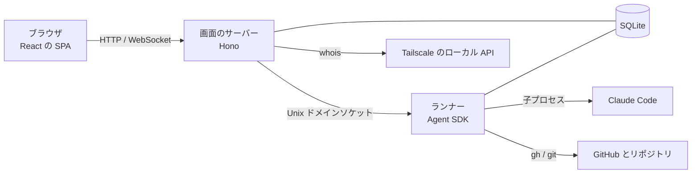

<!-- product-mode: webapp -->
# sukuna 設計書

- 種別: 設計書

## 目的とスコープ

Claude Code のエージェントを、プロジェクト・issue・会話の単位で動かして見張るための Web アプリを作る。Mac Studio に常駐させ、Tailscale につないだ PC のブラウザから、Vim と同じ操作感で使う。使うのは開発者 1 人である。

作るもの:

- 会話で AI に作業を頼み、発言・ツールの実行・差分を読み、質問に答える (UC-002〜UC-006)
- 全プロジェクトの会話と issue を、判断待ち・指示待ち・作業中に分けた一覧で見る (UC-001)
- issue を作ると、精査・設計・設計レビュー・実装・merge までを AI が進める自動フロー (UC-007〜UC-012)
- worktree、ターミナル、プロジェクトの設定、アプリの導入と保守 (UC-013〜UC-015)

初期版でやらないこと:

- スマホの画面 (UC-016)。PC の画面を先に作る。サーバーの API とデータの持ち方は、スマホから同じものを使える形にしておく
- ブラウザの通知 (Web Push と Service Worker)。アプリは `http://macstudio:<port>` で開き、対応が要る変化は、画面の中のお知らせとタブの題名の件数で知らせる。通知を出す判定と記録は作るので、HTTPS で開く構成にしたときは、通知の送信と購読だけを足す
- iPhone への通知
- ダークテーマ
- 複数人での利用

## アーキテクチャと技術選定

### 全体構成

プロセスは 2 つに分ける。画面のサーバーを入れ替えても AI を止めないためである (BR-069)。

| プロセス | 役割 |
| --- | --- |
| 画面のサーバー | SPA の配信、API、WebSocket での配信、本人の判定、ファイルの読み取りと検索、ターミナル、Web Push の送信。開発者の操作で行う `git` と `gh` の実行 (worktree の一覧・作成・削除、設計の差分、PR の取得と投稿、issue の取り込み) |
| ランナー | 会話ごとの Agent SDK の実行、会話のイベントの保存、自動フローの進行、目次などの更新、利用枠の戻りを待つタイマー |

- 2 つのプロセスは同じリポジトリの別の入口から起動する。データは同じ SQLite のファイルを共有する
- 画面のサーバーからランナーへの操作 (指示の送信、停止、分岐など) は、Unix ドメインソケットの上の HTTP で送る
- ランナーから画面のサーバーへは、同じソケットの上の配信 (改行区切りの JSON) で「どの会話・issue が変わったか」を知らせる。中身は SQLite から読む。画面のサーバーが再起動しても、保存済みの通し番号から読み直せる
- ランナーが再起動したときの扱いは「横断規約 > ランナーの再起動」に書く

### 層と依存の向き

`fullstack-worker-template` の構成に、ランナーを足す。

| ディレクトリ | 中身 |
| --- | --- |
| `src/front` | SPA。`pages`、`components`、`buffer` (Vim のバッファの土台)、`lib` |
| `src/server` | 画面のサーバー。`main.ts` (入口)、`app.ts` (組み立て)、`modules/<コンテキスト>/{domain,usecase,adapter}`。プロセスに 1 つだけ置く部品として `runtime.ts` (データベースの接続と WebSocket の受け口)、`ws-hub.ts` (配信)、`runner-link.ts` (ランナーとの接続) |
| `src/runner` | ランナー。`main.ts` (入口)、`app.ts` (組み立て)、`modules/<コンテキスト>/{domain,usecase,adapter}` |
| `src/shared` | 画面・サーバー・ランナーが共有する型と Zod のスキーマ (API の入出力、イベント、プロセスの間のやりとり、データベースのスキーマ)。入出力を持たないドメインの関数 (例: 依存の循環の検査) も置く |

- `domain` はフレームワークにも外側の層にも依存しない。`usecase` は `domain` だけに依存する。`src/front` は `src/server` と `src/runner` を import しない。境界は lint で強制する (PoC `vite-plus-node-stack`)
- 外界 (Agent SDK、`git`、`gh`、時計、乱数、Tailscale、Web Push) は `domain` の Port で受け、組み立ての場所で実物を渡す。テストでは偽物に差し替える
- コンテキストは次の 9 つとする: `conversation`、`recap`、`stock`、`issue`、`flow`、`workspace` (プロジェクト・worktree・ファイル・ターミナル)、`inbox` (一覧・未読・通知)、`identity` (本人の判定)、`settings`

### 技術選定

| 層 | 技術 | 選定理由 |
| --- | --- | --- |
| ツール | Vite+ (`vp`)、pnpm、lefthook | テンプレートと同じ。開発・テスト・lint・ビルドを `vp` に揃える。1 つのプロジェクトで SPA とサーバーを開発・テスト・ビルドできた (PoC `vite-plus-node-stack`) |
| 画面 | React 19、React Router、SWR、Tailwind CSS v4 | テンプレートと同じ |
| 画面のバッファ | CodeMirror 6、`@replit/codemirror-vim` | 1 万行に追記しながら操作しても、描画まで最大 21 ミリ秒だった (PoC `codemirror-vim-buffer`) |
| サーバー | Node.js、Hono (`@hono/node-server`) | テンプレートの Hono を Node.js で動かす。Mac Studio に常駐させるため Cloudflare には依存しない |
| AI の実行 | Claude Agent SDK (TypeScript) | 会話、skills、選択式の質問、再開、停止、分岐がすべて成立した (PoC `agent-sdk-conversation`、`agent-sdk-resume`、`agent-sdk-interrupt`、`agent-sdk-thread`) |
| データ | SQLite (`better-sqlite3`)、Drizzle ORM | 1 台で動かすので別のデータベースのサーバーが要らない。Drizzle ORM の安定版には Node.js 組み込みの SQLite のドライバが無い (PoC `vite-plus-node-stack`) |
| 画面との通信 | REST の API と WebSocket (`ws`) | 操作は API、AI の出力と状態の変化の配信は WebSocket に分ける |
| 検証と型 | Zod、neverthrow、ulid | テンプレートと同じ |
| テスト | Vitest (`vp test`)、Testing Library、Playwright、fast-check (`@fast-check/vitest`)、Stryker | 画面 (jsdom) とサーバー (本物の SQLite) を 1 つの設定で流せた (PoC `vite-plus-node-stack`)。fast-check と Stryker は、Vitest と Vite+ の設定を変えずに、2 つの project の両方で動く |
| 本人の判定 | Tailscale のローカル API の whois | `tailscale serve` を使わない構成で、接続元の持ち主を 1 ミリ秒未満で判定できた (PoC `tailscale-identity`) |
| 通知 | Web Push (`web-push`、VAPID)、Service Worker | 購読・送信・ページを閉じた状態での受信・取り下げが通った (PoC `web-push-tailscale`) |
| ターミナル | `node-pty`、xterm.js | 擬似端末がビルドの成果物から動いた (PoC `vite-plus-node-stack`) |

却下した案:

| 却下した案 | 採用した案 | 理由 |
| --- | --- | --- |
| Tailscale の HTTPS (`tailscale serve`) で配信して Web Push を使う | サーバーが 0.0.0.0 で待ち受け、`http://macstudio:<port>` で開く。通知は、ページが安全なオリジンとして開かれているときだけ有効にする | `tailscale serve` を使わないと決めたため。`http://macstudio:<port>` では Chrome が Service Worker と通知を使わせない。Chrome の例外指定をするか HTTPS で開くと使える (PoC `web-push-tailscale`)。有効にする手段は「未解決の論点」に書く |
| 追記のたびにエディターの状態を作り直す (UI スケッチの作り) | 追記を transaction の dispatch で行う | 作り直すと、入力途中の回数の指定・ビジュアルモード・検索の入力欄が消え、スクロールの位置も飛ぶ (PoC `codemirror-vim-buffer`) |
| 既存のスキルを、GitHub の issue とラベルのまま動かす | issue の読み書きを、アプリが AI に渡すツールに読み替えさせる | issue をアプリで管理するため (BR-033)。既存のスキルは `gh` で GitHub の issue を読み書きする。アプリのツールを AI が呼べることは確かめた (PoC `agent-sdk-conversation`) |
| サーバーを Bun で動かす | Node.js | Agent SDK と擬似端末の部品を Bun で確かめる手間が増える |

### AI の実行の作り

- 1 つの会話は、ランナーの中の 1 本の実行として動かす。開発者の指示は、開いたままの入力の流れに足して送る
- ユーザーの設定 (`~/.claude` の skills、プラグイン、CLAUDE.md、hooks) は、端末の Claude Code と同じに読み込ませる
- 選択式の質問と許可の確認は、ランナーが受け取って保存し、開発者の回答が届くまで待たせる
- スレッドは、元の会話の分岐として作る。分岐は会話の履歴だけを分け、ファイルは元の会話と共有する
- 精査・設計・実装の AI も、それぞれ 1 つの会話として動かす。会話の最初の指示で、既存のスキル (`dev-triage`、`dev-feat-spec`、`dev-impl`) の手順を使うことと、issue の読み書きをアプリのツールで行うことを伝える (「横断規約 > 自動フローと既存のスキル」)
- 目次・決まったこと・質問の一覧は、AI の番が終わるたびに、ツールを持たない小さいモデルの別の実行で更新する。前回の一覧と新しい 1 往復だけを渡し、変更点だけを出させる (PoC `summary-ai-cost`)

## 開発・検証コマンド

| 用途 | コマンド |
| --- | --- |
| 依存の導入 | `vp install` |
| 開発 (SPA と画面のサーバー) | `vp dev --port <port> --strictPort` |
| 開発 (ランナー) | `vp run dev:runner` |
| テスト (画面とサーバーとランナー) | `CI=1 vp test --run` |
| 型・lint・フォーマットの検査 | `vp check` |
| ビルド | `vp build` |
| マイグレーションの生成 | `vp exec drizzle-kit generate --dialect sqlite --schema ./src/shared/db/schema.ts --out ./src/shared/db/migrations --breakpoints` |
| E2E | `vp run e2e` |
| 変異テスト (全体) | `vp run mutation` |
| 変異テスト (ファイルを指定) | `vp run mutation --mutate <パス>[,<パス>]` |
| 変異テスト (基準から変えたファイル) | `vp run mutation:changed [<基準の ref>]` (既定は `origin/main`) |
| 本番の起動 | `PORT=<port> node dist/server/main.js` と `node dist/runner/main.js` |

- コマンドは `vp` に揃え、`pnpm`・`vite`・`vitest` を直接実行しない
- 入出力を持たない関数で入力の組み合わせが多いものは、fast-check の property テストで性質を確かめる。ファイルは対象の隣に `<対象>.prop.test.ts` の名前で置く。性質には、対象を何もしない処理に置き換えると落ちる正の性質を 1 つ以上入れる。不変条件だけでは、何もしない処理でも通るためである
- property テストの seed は、いつものテストでは実行のたびに変わり、落ちたテストの名前に出る。Stryker が流すときだけ、`src/test/fast-check.ts` が seed を固定する。変異ごとに入力が変わると、同じ変異でも、捕まえたかどうかが実行のたびに変わるためである
- 変異テストの設定は `stryker.config.json` に置き、レポートは `reports/mutation/mutation.html` に出る。`mutation:changed` は `scripts/mutation-changed.sh` を呼び、基準から変えた `src` のソース (テスト・`.d.ts`・`src/test/` を除く) だけを対象にする。対象が無ければ流さずに終わる
- worktree のセットアップ: チェックアウトの直後に `vp install` を実行する。`.env` 系のファイルは使わず、設定は環境変数で渡す
- Playwright のセットアップ: 初回だけ `vp exec playwright install chromium` を実行してブラウザを入れる。`vp run e2e` は `e2e/start-server.sh` で `vp dev` を起動し、既に動いているサーバーには相乗りしない (`reuseExistingServer: false`)。`SUKUNA_HOME` には実行ごとの一時ディレクトリを渡し、終了時に消す。並列で流すときは `PORT=5190 vp run e2e` のようにポートをずらす
- ポートは `--port` (開発) と環境変数 `PORT` (本番と E2E) で外から指定する。指定したポートで起動できなければ失敗させる (`--strictPort`)。並列の検証で使う基準のポートは 5180 とし、worktree ごとに 10 ずつずらして使う (5180、5190、5200)
- データの置き場所は環境変数 `SUKUNA_HOME` で指定する (既定は `~/.sukuna`)。テストと E2E は、実行ごとに作った一時ディレクトリを指定する
- テストと E2E は、本物の Claude も GitHub も呼ばない。Agent SDK と `gh` は Port の偽物に差し替える。Agent SDK の偽物は、台本どおりにイベントを流し、アプリのツールの呼び出しでは登録した処理を実際に呼ぶ。E2E は、偽物を使う設定で画面のサーバーとランナーを起動する
- 環境変数は次のとおりとする。値の形、既定の値、読むプロセスは `features/operations.md`「環境変数」が正本である

| 環境変数 | 用途 |
| --- | --- |
| `SUKUNA_HOME` | データの置き場所 |
| `PORT` | 画面のサーバーが待ち受けるポート |
| `CLAUDE_CONFIG_DIR` | Claude Code の設定の置き場所。タイムラインのファイルを探すときに読む |
| `SUKUNA_LOGIN` | 開発者の Tailscale のログイン名。本人の判定がすべての API を塞ぐので、画面からは設定しない |
| `SUKUNA_RUNNER_SOCKET` | ランナーのソケットのパス |
| `SUKUNA_AGENT`、`SUKUNA_AGENT_SCRIPT` | Agent SDK を偽物に差し替える指定と、その台本 |
| `SUKUNA_GH` | `gh` を偽物に差し替える指定 |
| `SUKUNA_DEV_IDENTITY` | 開発と E2E で、手元 (`127.0.0.1` と `::1`) からの接続を本人として扱う指定 |
| `SUKUNA_LOG_LEVEL` | ログの細かさ |
| `NODE_ENV` | `production` のときを本番の起動とする。本番の起動では、偽物の指定と `SUKUNA_DEV_IDENTITY` があると起動を失敗させる |

- `.gitignore` に `.claude/worktrees/` を入れる

## データスキーマ

SQLite のファイルを 1 つ使う。識別子は ULID の文字列、時刻は Unix ミリ秒の整数とする。JSON の列は Zod のスキーマで読み書きする。

| テーブル | 主な列 | 役割 |
| --- | --- | --- |
| `projects` | `id`、`name`、`path`、`uses_github`、`default_branch`、`permission_mode`、`model`、`design_merge_mode`、`auto_stages`、`impl_concurrency`、`confirm_before_merge_default`、`flow_paused`、`removed_at` | 登録したプロジェクトと、自動フローの設定。`auto_stages` は自動で処理する段階 (`triage` / `design` / `impl`) の配列。`confirm_before_merge_default` は新しい issue の merge 前の確認の初めの値 |
| `conversations` | `id`、`project_id`、`kind`、`issue_id`、`parent_conversation_id`、`title`、`session_id`、`cwd`、`worktree_id`、`run_state`、`stop_reason`、`resets_at`、`last_seq`、`last_read_seq`、`last_position`、`recap_seq`、`recap_failed_at`、`last_activity_at`、`closed_at` | 会話。`kind` は `chat` / `triage` / `design` / `impl` / `thread` |
| `conversation_events` | `conversation_id`、`seq`、`type`、`payload`、`sdk_uuid`、`created_at` | 会話のイベントの記録。画面はこの記録を表示する |
| `drafts` | `conversation_id`、`text`、`images`、`updated_at`、`updated_by` | 書きかけの入力。会話ごとに 1 つ |
| `queued_instructions` | `id`、`conversation_id`、`text`、`images`、`position`、`stock_item_id`、`client_id`、`created_at`、`timeline_comments` | 届く前の指示。`client_id` は二重の送信を見分ける値。ストックから送った指示は、元のストックを指す。相談の配列の扱いは `features/work-monitor.md`「相談コメントの保存と抽出」に従う |
| `pending_answers` | `conversation_id`、`question_seq`、`answers`、`updated_at` | 送る前の回答 |
| `stock_items` | `id`、`conversation_id`、`kind`、`text`、`quote`、`state`、`sent_at`、`sent_seq`、`thread_conversation_id`、`github_comment_url` | 質問と指示のストック。`kind` は `question` / `instruction`、`state` は `stocked` / `sent` / `cancelled` |
| `toc_entries` | `conversation_id`、`position`、`title`、`start_seq` | 目次の章 |
| `questions` | `id`、`conversation_id`、`seq`、`kind`、`text`、`answered` | AI が判断を求めている質問の一覧。`kind` は `choice` (選択式) / `text` (文章) |
| `issues` | `id`、`project_id`、`number`、`title`、`body`、`kind`、`state`、`stop_reason`、`parent_id`、`priority`、`designed`、`confirm_before_merge`、`pr_url`、`github_number`、`created_conversation_id`、`created_at`、`updated_at`、`closed_at` | issue。`state` は BR-039 の 9 つ |
| `issue_dependencies` | `issue_id`、`depends_on_id` | 依存 |
| `issue_events` | `issue_id`、`seq`、`type`、`payload`、`created_at` | issue に起きたことの記録。状態の移り変わり、段階の変化、コメント、AI の報告 |
| `worktrees` | `id`、`project_id`、`path`、`branch`、`branch_created`、`origin`、`issue_id`、`port_slot`、`removed_at` | worktree。`origin` は `user` / `flow`。`port_slot` は検証のポートを issue ごとに分ける番号。worktree の名前は、`path` の最後のディレクトリの名前とする |
| `pr_snapshots` | `issue_id`、`pr_url`、`payload`、`fetched_at` | 最後に GitHub から取得した PR。取得できないときの表示に使う |
| `notifications` | `id`、`target_kind`、`target_id`、`reason`、`title`、`body`、`created_at`、`dismissed_at` | 出した通知 |
| `push_subscriptions` | `id`、`endpoint`、`keys`、`user_agent`、`created_at` | Web Push の購読 |
| `settings` | `key`、`value` | アプリ全体の設定。キーの割り当て、全体の一時停止、最後に受け取った利用枠の状態など |

- 会話の記録は、Agent SDK が持つ記録とは別に、`conversation_events` に保存する。画面の表示、未読の位置、引用の位置は `seq` で指す。Agent SDK の記録は、AI の文脈を続けるためだけに使う
- `conversations.stop_reason` は `user` / `restarted` / `api_error` / `error` / `credits_required` / `usage_limit` とする。`run_state` との対応は `features/conversation.md` が正本である
- `conversations.last_position` は、前回読んでいた行のイベントの `seq` とする。`recap_seq` は、目次などの更新に反映した最後の `seq` である
- 貼り付けた画像は `SUKUNA_HOME` の下のファイルで持ち、`drafts.images` と `queued_instructions.images` は画像の識別子の配列とする
- どの列をどちらのプロセスが書くかは `features/runtime.md`「書くプロセスの分担」が正本である。同じ列を 2 つのプロセスが書くのは、分担の表に挙げた列だけとし、その更新は元の値を条件にして、前の変化を上書きしないようにする
- `conversations.run_state` は `idle` / `working` / `waiting_answer` / `waiting_permission` / `stopped` / `failed` / `usage_limited` とする。一覧のセクション (判断待ち・指示待ち・作業中) は、この値と `questions`、issue の状態から求める (決まりは `features/inbox.md`)
- 決まったことの一覧は、データベースではなくリポジトリのファイルで持つ (BR-015。置き場所は `features/recap.md`)
- タイムラインは、タイムラインのプラグインが `~/.claude/timeline/sessions/<session_id>.json` に保存するファイルを読む。アプリのデータベースには写さない
- インデックス: `conversation_events (conversation_id, seq)` を主キーにする。`conversations (project_id, closed_at)`、`conversations (issue_id)`、`conversations (parent_conversation_id)`、`issues (project_id, state)`、`stock_items (conversation_id, state)` に付ける。どれも一覧と会話を開くときの絞り込みに使う
- 一意の制約: `projects (path)`、`issues (project_id, number)`、`issues (project_id, github_number)` (値があるときだけ)、`worktrees (project_id, path)` (`removed_at` が空のときだけ)、`conversation_events (conversation_id, sdk_uuid)` (値があるときだけ。Agent SDK の同じメッセージを二重に保存しない)
- 外部キー: 親を消すと子も消す関係にだけ張り、`ON DELETE CASCADE` とする。会話とそのイベント・書きかけ・届く前の指示・送る前の回答・ストック・目次・質問、issue とその依存・記録が当たる。残す参照 (`issues.created_conversation_id`、`stock_items.thread_conversation_id`、`conversations.worktree_id`、`conversations.issue_id`、`issues.parent_id`) には張らない。指す先が無いときの表示は、各機能設計書が決める
- マイグレーション: Drizzle Kit で SQL を生成してリポジトリに置き、両方のプロセスが起動時に未適用の分を当てる。当てるあいだだけ排他のロックを取り、動いているあいだはロックを持たない。画面のサーバーの入れ替えを、動いているランナーが待たせないためである (BR-069)

### トランザクション境界

| 操作 | 1 つのトランザクションに入れる書き込み |
| --- | --- |
| 会話のイベントの保存 | `conversation_events` への追加、`conversations` の `last_seq`・`run_state`・`last_activity_at` の更新 |
| 回答をまとめて送る | `pending_answers` の削除、`questions` の `answered` の更新、送った回答の `conversation_events` への追加 |
| ストックの質問を送る (質問 1 件ごと) | スレッドの `conversations` の追加、その `stock_items` の `state` の更新。1 件の失敗でほかの件を止めない |
| 届く前の指示を届ける | `queued_instructions` の削除、開発者の発言の `conversation_events` への追加、ストックから来た指示の `stock_items.sent_seq` の更新 |
| issue の状態を移す | `issues` の `state` の更新、`issue_events` への追加 |
| issue を確定する | `issues` の追加または更新、`issue_dependencies` の入れ替え、`issue_events` への追加 |

## API 一覧

パスは `/api` で始める。入出力は JSON とする。個別の詳細は各機能設計書の「API」節が正本である。

| メソッド | パス | 概要 | 機能設計書 |
| --- | --- | --- | --- |
| GET | `/api/me` | 本人の判定の結果 | `features/operations.md` |
| GET | `/api/inbox` | 一覧 (セクション分け、未読、作業中の状況) | `features/inbox.md` |
| GET | `/api/projects` | プロジェクトと、その会話・issue のツリー | `features/inbox.md` |
| GET | `/api/projects/:id/overview` | プロジェクトの画面 (状態ごとの issue と会話) | `features/inbox.md` |
| POST | `/api/push/subscriptions` | 通知の購読の登録 | `features/inbox.md` |
| DELETE | `/api/push/subscriptions/:id` | 通知の購読の解除 | `features/inbox.md` |
| POST | `/api/conversations` | 会話を始める | `features/conversation.md` |
| GET | `/api/conversations/:id` | 会話の状態 | `features/conversation.md` |
| GET | `/api/conversations/:id/events` | 会話のイベント (範囲の指定) | `features/conversation.md` |
| POST | `/api/conversations/:id/messages` | 指示を送る (預ける、割り込む) | `features/conversation.md` |
| POST | `/api/conversations/:id/stop` | AI を止める | `features/conversation.md` |
| POST | `/api/conversations/:id/resume` | 止まった作業を再開する | `features/conversation.md` |
| PUT | `/api/conversations/:id/draft` | 書きかけの入力を保存する | `features/conversation.md` |
| POST | `/api/conversations/:id/images` | 貼り付けた画像を保存する | `features/conversation.md` |
| PATCH | `/api/conversations/:id/queue/:itemId` | 届く前の指示を直す | `features/conversation.md` |
| DELETE | `/api/conversations/:id/queue/:itemId` | 届く前の指示を取り消す | `features/conversation.md` |
| PUT | `/api/conversations/:id/answers` | 送る前の回答を保存する | `features/conversation.md` |
| POST | `/api/conversations/:id/answers/send` | 回答をまとめて送る | `features/conversation.md` |
| POST | `/api/conversations/:id/permissions/:requestId` | 許可の確認に答える | `features/conversation.md` |
| POST | `/api/conversations/:id/read` | 既読の位置と読んでいた位置を保存する | `features/recap.md` |
| GET | `/api/conversations/:id/recap` | 直近 (最後の発言、質問の一覧、件数) | `features/recap.md` |
| GET | `/api/conversations/:id/toc` | 目次 | `features/recap.md` |
| PATCH | `/api/conversations/:id/toc/:position` | 目次の章を直す | `features/recap.md` |
| POST | `/api/conversations/:id/recap/rebuild` | 目次などを作り直す | `features/recap.md` |
| GET | `/api/conversations/:id/decisions` | 決まったことの一覧 | `features/recap.md` |
| PUT | `/api/conversations/:id/decisions` | 決まったことの一覧を直す | `features/recap.md` |
| GET | `/api/conversations/:id/stock` | ストックの一覧 | `features/stock-thread.md` |
| POST | `/api/conversations/:id/stock` | ストックに入れる | `features/stock-thread.md` |
| PATCH | `/api/stock/:id` | ストックを直す | `features/stock-thread.md` |
| DELETE | `/api/stock/:id` | ストックを取り消す | `features/stock-thread.md` |
| POST | `/api/conversations/:id/stock/send` | ストックを送る (全部、質問だけ、指示だけ) | `features/stock-thread.md` |
| GET | `/api/conversations/:id/threads` | スレッドの一覧 | `features/stock-thread.md` |
| POST | `/api/threads/:id/finish` | スレッドを終える (確定事項を指示としてストックに入れる) | `features/stock-thread.md` |
| GET | `/api/conversations/:id/files` | ファイルツリー | `features/files.md` |
| GET | `/api/conversations/:id/files/content` | ファイルの中身 | `features/files.md` |
| GET | `/api/conversations/:id/search` | ファイルの中身と名前の検索 | `features/files.md` |
| GET | `/api/conversations/:id/changes` | AI が変えた箇所 | `features/files.md` |
| GET | `/api/conversations/:id/closing-summary` | 締めくくりの確認 (成果と残り) | `features/conversation-lifecycle.md` |
| POST | `/api/conversations/:id/close` | 会話を閉じる | `features/conversation-lifecycle.md` |
| DELETE | `/api/conversations/:id` | 会話を削除する | `features/conversation-lifecycle.md` |
| GET | `/api/projects/:id/conversations` | 会話とスレッドの一覧 (閉じたものを含む) | `features/conversation-lifecycle.md` |
| GET | `/api/search` | issue と会話の検索 | `features/conversation-lifecycle.md` |
| GET | `/api/projects/:id/issues` | issue の一覧 | `features/issue.md` |
| POST | `/api/projects/:id/issues` | issue を作る (下書き、確定) | `features/issue.md` |
| GET | `/api/issues/:id` | issue の内容 | `features/issue.md` |
| PATCH | `/api/issues/:id` | issue を直す (下書きの編集、優先度、親と依存) | `features/issue.md` |
| POST | `/api/issues/:id/confirm` | 下書きを確定する | `features/issue.md` |
| POST | `/api/issues/:id/withdraw` | 取り下げる | `features/issue.md` |
| POST | `/api/issues/:id/reopen` | 閉じた issue を再開する | `features/issue.md` |
| GET | `/api/issues/:id/design` | 設計レビューの内容 (修正方針、設計書の差分、確かめたい点) | `features/design-review.md` |
| POST | `/api/issues/:id/design/approve` | 設計を承認する | `features/design-review.md` |
| POST | `/api/issues/:id/design/reject` | 設計を差し戻す | `features/design-review.md` |
| GET | `/api/issues/:id/progress` | 工程、進捗、タスクの木、タイムライン | `features/work-monitor.md` |
| GET | `/api/conversations/:id/progress` | 会話の工程、進捗、タスクの木、タイムライン | `features/work-monitor.md` |
| GET | `/api/issues/:id/pr` | PR の差分、CI の状況、証跡 | `features/pr-review.md` |
| POST | `/api/issues/:id/pr/allow-merge` | merge を許可する | `features/pr-review.md` |
| POST | `/api/issues/:id/pr/comments/publish` | 選んだ指摘を GitHub に投稿する | `features/pr-review.md` |
| GET | `/api/projects/:id/worktrees` | worktree の一覧 | `features/worktree-terminal.md` |
| POST | `/api/projects/:id/worktrees` | worktree を作る | `features/worktree-terminal.md` |
| DELETE | `/api/worktrees/:id` | worktree を消す | `features/worktree-terminal.md` |
| PUT | `/api/conversations/:id/workspace` | 会話の作業場所を切り替える | `features/worktree-terminal.md` |
| POST | `/api/terminals` | ターミナルを開く | `features/worktree-terminal.md` |
| POST | `/api/projects` | プロジェクトを登録する | `features/project-settings.md` |
| GET | `/api/projects/:id` | プロジェクトの設定と、解除すると止まる会話の数 | `features/project-settings.md` |
| GET | `/api/projects/:id/github-issues` | 取り込める GitHub の issue の一覧 | `features/project-settings.md` |
| PUT | `/api/settings/flow-paused` | 全プロジェクトの自動フローの一時停止 | `features/project-settings.md` |
| PATCH | `/api/projects/:id` | プロジェクトの設定を変える (一時停止を含む) | `features/project-settings.md` |
| DELETE | `/api/projects/:id` | プロジェクトを解除する | `features/project-settings.md` |
| POST | `/api/projects/:id/github-import` | GitHub の issue を取り込む | `features/project-settings.md` |
| GET | `/api/usage` | 利用量 | `features/project-settings.md` |
| GET | `/api/settings` | アプリの設定 (キーの割り当てを含む) | `features/operations.md` |
| PUT | `/api/settings/keymap` | キーの割り当てを変える | `features/operations.md` |
| POST | `/api/backup/restore` | バックアップから復元する | `features/operations.md` |

WebSocket は 2 本とする。

| パス | 概要 | 機能設計書 |
| --- | --- | --- |
| `/ws` | サーバーから画面への配信 (会話のイベント、一覧の変化、issue の変化、お知らせ)。形は「横断規約 > 配信」 | 横断規約 |
| `/ws/terminals/:id` | ターミナルの入出力 | `features/worktree-terminal.md` |

AI に渡すアプリのツールは、API とは別に `features/issue.md` の「AI に渡すツール」節に書く。

## 横断規約

### 挙動の方針

USECASES.md「挙動の方針」の写しである。機能設計書は、エッジケースの決定をここから導く。

| ID | 方針 |
|----|------|
| P1 | 送る前のもの（書きかけの入力、ストック、送る前の回答、届く前の指示）はサーバーに置き、端末の間で共有する。送るか自分で消すまで残す |
| P2 | 開発者が始めた作業の続きは自動で進める。開発者が書いた内容を送るのは、開発者の操作だけにする |
| P3 | 読んだ・決めたという事実は端末の間で共有する。画面の見え方（カーソル、開いている表示）はブラウザのタブごとに持つ |
| P4 | 開発者の対応が要る変化は、どこで起きても一覧と通知に出す。いま見ているものには出さない |
| P5 | AI に直しを頼むと issue は作業中の状態に戻り、直し終えると元の確認に戻る |
| P6 | 取り返しのつかない操作は、PC では確認、スマホでは 5 秒の猶予を挟む。猶予のあいだは実行しない |

P1 の例外が 1 つある。引用に質問か指示を書いている途中の文は、ストックに入れるまで、ブラウザのタブの中だけに持つ。短い文で、引用の位置と組で意味を持つためである。

### エラー応答

- 失敗した API は、HTTP の状態コードと `{ "error": { "code": "<コード>", "message": "<開発者に見せる文>" } }` を返す。`error` には、機能が決めた `details` を足してよい。中身は各機能設計書の「API」節で決める
- 共通のコード: `unauthorized` (401。本人ではない)、`not_found` (404)、`invalid_input` (400。Zod の検査に落ちた)、`conflict` (409。状態が合わない操作)、`runner_unavailable` (503。ランナーにつながらない)、`github_unavailable` (502。GitHub から取得できない)、`internal` (500)
- 機能に固有のコードは、各機能設計書の「API」節で足してよい (例: `dependency_cycle`、`unanswered_questions`)。HTTP の状態コードは、上の共通のコードと同じ分け方に合わせる
- `message` は、何が起きたかと、次にできることを日本語で書く。画面は `message` をそのままお知らせに出す
- サーバーとランナーの内側では、失敗を neverthrow の `Result` で返し、例外は境界 (API のハンドラ、ランナーの実行の入口) でだけ捕まえる

### 本人の判定

- すべての API と WebSocket の接続で、ソケットの接続元の IP アドレスだけを見て判定する。`X-Forwarded-For` などのヘッダーは使わない
- 接続元が Tailscale の範囲 (100.64.0.0/10) に入らなければ、問い合わせをせずに拒否する
- 入っていれば、Tailscale のローカル API の whois で持ち主のログイン名を取り、環境変数 `SUKUNA_LOGIN` に設定した開発者のログイン名と一致するときだけ通す。問い合わせの失敗と不一致は拒否する
- 開発 (`vp dev`) と E2E のためだけに、環境変数 `SUKUNA_DEV_IDENTITY` を設定したときは 127.0.0.1 からの接続を本人として扱う。本番の起動 (`NODE_ENV=production`) では、この変数があると起動を失敗させる
- ログイン画面は作らない (BR-068)

### 配信

- `/ws` は、接続のたびに本人の判定を通す。画面は、見ている対象 (一覧、会話、issue) を購読として送り、サーバーはその対象の変化だけを配信する。死活確認の `app` の `ping` は購読によらず全接続へ送る (`features/runtime.md`「配信」)
- 配信の 1 件は `{ "topic": "<対象>", "seq": <通し番号>, "type": "<種類>", "payload": { ... } }` とする。画面は、受け取った `seq` を覚え、つなぎ直したときに続きから受け取る
- 配信が途切れたあいだの分は、つなぎ直したときに API で読み直す。配信だけを頼りに画面の状態を作らない
- 画面の入力 (指示の送信、停止など) は WebSocket ではなく API で送る

### 自動フローと既存のスキル

- issue の状態を移すのは、ランナーの `flow` だけとする。AI は、アプリのツールで「精査の結果」「設計の完了」「実装の完了」を報告し、`flow` が状態を移す
- 精査・設計・実装の会話は、最初の指示で次を伝える: 使う手順 (`dev-triage`、`dev-feat-spec`、`dev-impl` のスキルの本文)、対象の issue の番号、issue の読み書きと状態の報告にアプリのツールを使うこと、GitHub の issue・ラベル・Project を操作しないこと
- PR・CI・merge は、GitHub を使うプロジェクトでは `gh` のまま行わせる (BR-052)
- worktree の作成と片付け、同時に実装する件数の制限は、AI ではなく `flow` が行う (BR-042、BR-048、BR-050)。実装の会話は、`flow` が用意した worktree の中で、issue 1 件だけを扱う
- 開発者が始めた会話にも、アプリのツールを渡す。`/dev-spec` が作る issue は、アプリのツールで登録させる

### ランナーの再起動

- ランナーは、起動時に、前回の起動で残った Claude Code の子プロセスを止めてから始める。止めないと、同じ会話の記録に 2 か所から書き込まれる
- 開発者が始めた会話は、再起動のあと「作業が止まった」と表示し、指示が送られるまで動かさない
- 自動フローの会話は、再起動のあとに自動で続きから始める
- 利用枠切れで止まっていた会話は、保存してある戻る時刻から、待つタイマーを張り直す

### ログ

- 画面のサーバーとランナーは、1 行 1 件の JSON を標準出力に出す。項目は `time`、`level`、`component`、`message` と、関係する `conversation_id` / `issue_id` とする
- 会話の本文と、ファイルの中身はログに出さない
- 利用枠切れを知らせるイベントは、形の確認のため、受け取ったままの形で 1 件ずつログに残す (「既知の制約」)

### 画面の共通の作り

- すべてのウィンドウ (ツリー、主のウィンドウ、右のウィンドウ) は、読み取り専用の Vim のバッファとして作る。行は本物の文字列で、列・印・枠は装飾で付ける。作りは `features/buffer-ui.md` が正本である
- 取り返しのつかない操作 (承認、merge の許可、取り下げ、削除、worktree の削除、プロジェクトの解除、復元) は、実行の前に y / n の確認を挟む
- 明るさはライトだけとする

### アプリシェル

| 項目 | 決定 |
| --- | --- |
| グローバルレイアウト | ヘッダーは置かない。左にツリー、中央に主のウィンドウ、右のウィンドウは必要なときだけ出す。下にステータス行を置く。入力欄は `i` を押したときだけ出す。主のウィンドウの本文は、ウィンドウの幅いっぱいまで使う |
| 認証ガード | ログイン画面は作らない。`/api/me` が本人ではないと返したら、アプリの代わりに拒否の画面を出す |
| 404 / 権限なし / ネットワークエラー | 主のウィンドウの中に出し、「一覧へ戻る」と「再読み込み」を置く。ツリーは使えるまま残す。サーバーにつながらないあいだは、最後に取得した内容と、つながらないことを表示する |
| グローバルトースト (お知らせ) | ステータス行のすぐ上の右端に出す。エラーは最新の 1 件だけを、Esc で消すまで残し、画面を移っても消さない。ほかのお知らせは最新の 1 件だけを、エラーの下に出し、4 秒で消す |
| ErrorBoundary | アプリ全体と、ウィンドウごとの 2 段に置く。1 つのウィンドウが壊れても、ほかのウィンドウは使える |
| loading 表示 | 一覧と会話は Skeleton、操作の実行中は Spinner を、ウィンドウごとに出す |

#### テスト方針

| 確かめること (アプリシェルの決定から起こした) | レベル |
| --- | --- |
| Tailscale の範囲に入らない接続元から API を呼ぶと、401 と `unauthorized` が返る | 結合 |
| 本人ではないと判定されたときにアプリを開くと、拒否の画面が出て、ツリーも主のウィンドウも出ない | 単体 |
| 存在しない会話か issue を開くと、主のウィンドウに見つからないことが出て、「一覧へ戻る」を選ぶと一覧が開く | E2E |
| サーバーにつながらないあいだは、最後に取得した内容とつながらないことが出て、つながると自動で消える | 単体 |
| エラーのお知らせは、画面を移っても Esc を押すまで残り、ほかのお知らせは 4 秒で消える | 単体 |
| 1 つのウィンドウの描画が失敗しても、ほかのウィンドウは操作でき、失敗したウィンドウに再読み込みが出る | 単体 |
| 一覧を開くと、読み込みのあいだ Skeleton が出る | なし (分岐の無い表示で、機能の E2E が一覧を開くたびに通る) |

E2E 対象動線: 存在しない会話か issue を開くと、主のウィンドウに見つからないことが出て、「一覧へ戻る」を選ぶと一覧が開く

## ドメインモデル

| 集約 | 持つもの | 不変条件 |
| --- | --- | --- |
| 会話 | イベントの記録、書きかけの入力、届く前の指示、送る前の回答、既読の位置 | 同じ会話を動かす実行は、同時に 1 つだけ。`seq` は会話の中で 1 ずつ増える |
| ストック | 質問と指示、引用 | 引用 1 つにつき 1 件。送ったあとは編集できない |
| issue | 内容、状態、親、依存、優先度 | 状態は BR-039 の 9 つ。同じ issue の AI は同時に 1 つだけ (BR-041)。依存は循環しない。親は実装の対象にしない (BR-036) |
| プロジェクト | 設定、worktree | 同時に実装する issue は設定した件数まで (BR-042) |

issue の状態の移り変わりは `features/issue-flow.md` の表が正本である。実装から merge までの進め方は `features/implementation-flow.md`、プロセスの間のやりとりと配信の作りは `features/runtime.md` に書く。

## インフラ

- 動かす場所: Mac Studio。launchd で、画面のサーバーとランナーを別々のサービスとして常駐させる。Mac の再起動のあとも自動で起動する (UC-015 C)
- 画面のサーバーは 0.0.0.0 の指定したポートで待ち受け、`http://macstudio:<port>` (Tailscale の MagicDNS の名前) で開く
- データは `SUKUNA_HOME` (既定は `~/.sukuna`) に置く。中身は、SQLite のファイル、貼り付けた画像、VAPID の鍵、ランナーのソケット、子プロセスの記録、バックアップ、ログである。ファイルの名前と形は `features/runtime.md` と `features/operations.md` が正本である
- 配置先には `node_modules` が要る。SQLite のドライバと擬似端末の部品は、ビルドの成果物に同梱しない
- 更新: リポジトリを更新して `vp install` と `vp build` を行い、画面のサーバーだけを入れ替える。ランナーを入れ替えるのは、ランナーのコードが変わったときだけにする
- バックアップ: SQLite のデータベースを、SQLite のバックアップの機能で写す。貼り付けた画像は含めない。復元は、2 つのプロセスを止めてから行う。手順は `features/operations.md` に書く
- CI: GitHub Actions で `vp check`、`CI=1 vp test --run`、`vp build` を実行する。PR のときは、別のジョブ (`mutation`) で `vp run mutation:changed` を PR の基準のブランチに対して流す。全体を流すと PR ごとの待ち時間が長くなりすぎるので、変えたファイルだけにする。変異スコアでは PR を落とさない。今あるコードには生き残りの変異があり、そのファイルに触れた無関係の PR まで落ちるためである。`mutation` ジョブの準備 (ripgrep などの道具の導入) は `ci` ジョブと揃える。テストが呼ぶ道具が無いと、Stryker の初回のテスト実行で落ちる
- シークレット: アプリは API キーを持たない。AI の実行は、この Mac の Claude Code のログインを使う (「未解決の論点」)

## 既知の制約

- rg は `RIPGREP_CONFIG_PATH` の設定でリンクの追跡や無視の対象を変えられる。一覧と中身の検索では、子プロセスの環境からこの変数だけを除く ([公式ガイド](https://github.com/BurntSushi/ripgrep/blob/master/GUIDE.md#configuration-file))
- ファイル名には改行も含まれる。rg の一覧は `--null`、Git の一覧は `-z` で NUL 区切りにし、改行で分けない
- macOS では `/var` と `/private/var` のように同じディレクトリに別の絶対表記がある。記録の差分を相対パスへ直すときは、作業ディレクトリの表記と実体の表記をともに照合する
- `realpath` の不存在エラーは、参照先が消えたシンボリックリンクにも返る。削除済みの差分の検査では、残るリンクを `lstat` で見分け、`readlink` の参照先と未解決の末尾も含めて作業ディレクトリ内かを判定する
- `rg --files` は、既定ではシンボリックリンクの名前も返さない。`git ls-files --cached --others --exclude-standard -z` の一覧から、実体をたどらず `lstat` でリンクを選ぶ。`git check-ignore --no-index -z --stdin` で無視の対象を除き、ファイルツリーと名前の検索の一覧に補う
- rg の JSON 出力では `--max-columns` が効かない。中身の検索の本文は、サーバーで先頭の 500 文字に切る。列番号は元の行の最初の一致を指す
- CodeMirror の文字の位置は UTF-16 コード単位で数え、サロゲートペアは 2 単位になる。中身の検索の列も同じ単位で返す ([公式ガイド](https://codemirror.net/docs/guide/#data-structures))
- Vite+ のテストのファイルキャッシュに、`import.meta.glob` が集めたマイグレーションの一覧が残ることがある。SQL ファイルを追加したあとに一覧が更新されなければ、`vp test --clearCache` を実行してからテストを流す
- `http://macstudio:<port>` は安全なオリジンではない。Service Worker、通知の許可、Web Push の購読は使えない。使えるかは実行時に判定し、使えないときは通知の購読を試みない (PoC `web-push-tailscale`)
- 通知の取り下げは Web Push の仕組みに無い。取り下げ用の push を送り、Service Worker が同じ `tag` の通知を探して閉じる。push を受けて通知を 1 件も出さないと、Chrome が代わりの通知を出すことがある
- Agent SDK の停止は、入力を流れとして渡した実行でだけ使える。バックグラウンドへ移ったコマンドは停止では止まらず、終わると AI の番が自動で始まる。停止の操作では、動いているバックグラウンドのタスクも止める (PoC `agent-sdk-interrupt`)
- 作業中に優先度を付けずに送った指示は、実行中のツールが終わった時点で同じ番に入る。届く前の指示は、ランナーが保持し、番の終わりを受けてから 1 通につないで送る
- 会話を再開しても、許可の設定・使えるツール・アプリのツールは戻らない。実行を開くたび (会話の開始と、止まった会話の再開) に、プロジェクトのその時点の設定から組み立てて渡す。動いている実行には、開いたときの設定が効き続ける
- 再開のあとの作業ディレクトリは、渡したディレクトリになる。Agent SDK が返す会話の情報の作業ディレクトリは最初のままなので、いまの作業ディレクトリは `conversations.cwd` で持つ
- 同じ会話を、同時に 2 つのプロセスで再開しない。画面のサーバーやランナーを強制終了すると、Claude Code の子プロセスが残って作業を続ける
- Unix ドメインソケットは、待ち受け中でもファイルを削除できる。ランナーは `<ソケットのパス>.lock` の排他のロックで、残ったファイルの確認・削除・待ち受けの確保を直列にする。ロックは確保後に外し、復旧処理の前にほかのランナーの起動を拒む。
- Claude Code の会話の記録は、既定で 30 日後に消える。会話の実行には SDK の `settings: { cleanupPeriodDays: 36500 }` を渡し、保存期間を 36,500 日にする。ユーザーの設定ファイルは書き換えない。`0` は無効なので使わない (PoC `session-retention`)
- 作業中の会話から分岐すると、実行途中のツールの呼び出しが「中断され結果不明」として分岐した側に写る (PoC `agent-sdk-thread`)
- 利用枠切れは、利用枠の状態を知らせるイベントの「上限に達した」で判定する。発言に付くエラーの種類だけでは判定しない (クレジット不足にも同じ種類が付く)。超過分の利用が許可されているときは利用枠切れと扱わない。クレジットの購入が要る場合は、時刻を待っても戻らないので自動では再開しない。戻る時刻は秒単位で、省略されることがある。無いときは 15 分ごとに再開を試みる (PoC `usage-limit-detect`)
- 上限に達したときのイベントの実物は、まだ観測していない。実装の初期にログへ残し、上の判定を実物で確かめる
- React の StrictMode は、開発時に Effect の生成と破棄を追加で繰り返す。入力欄を閉じて本文を返す処理は、終了操作・画面移動・欄の差し替えで行う。エディターの破棄は、入力欄の終了として扱わない ([React 公式ドキュメント](https://react.dev/reference/react/StrictMode#fixing-bugs-found-by-re-running-effects-in-development))
- CodeMirror のエディターの状態は、開くときに 1 度だけ作る。追記と行の書き換えは transaction の dispatch で行い、状態を作り直さない。読み取り専用は、追記用の印が付いた transaction だけを通す形で作る (PoC `codemirror-vim-buffer`)
- CodeMirror Vim は、途中まで合う追加キーより、最後まで合う組み込みキーを先に使う。`Space` と `Ctrl+w` は先頭で受け止め、キー列が完成してから Vim に渡す。`f` / `t` などが次の文字を待つ間は、その文字を Vim に直接渡す
- 同じ worktree で `vp build` と `vp dev` を並行すると、最適化した依存の URL が古くなり、画面の読み込みが 504 になることがある。順に実行し、発生時は `vp dev --force` で再起動する
- `vp dev` では、Hono の WebSocket の部品が使えない。WebSocket は `ws` の受け口を 1 つ作り、開発と本番の両方から同じものを呼ぶ (PoC `vite-plus-node-stack`)
- `vp dev` で API のファイルを編集しても、データベースの接続・配信・WebSocket の受け口は作り直さない。プロセスに 1 つのモジュールに置く
- ブラウザの WebSocket API は、制御フレームの Ping/Pong を公開しない。死活確認は `app` の `ping` メッセージで行う。形と間隔は `features/runtime.md`「配信」に従う (WHATWG WebSockets「Ping and Pong frames」)
- `vp dev` では Vite が `/api` 以外のパスを配るため、本人の判定を受けるのは API だけになる。本番の起動では画面のサーバーが静的ファイルと SPA の HTML も判定し、本人でなければ拒否の HTML を返す
- `vp dev` の `localhost` は `::1` で待ち受けることがあるため、開発用の本人の値は `127.0.0.1` と `::1` の両方を手元として扱う
- SQLite の `PRAGMA journal_mode = WAL` はファイルに残るが、`busy_timeout` と `foreign_keys` は接続ごとの設定である。`journal_mode` と `foreign_keys` はトランザクションの中では変えられない。接続を開いた直後に 3 つとも設定する
- ロックファイルの PID を読んでから削除する間には、別のプロセスが同じパスを取得できる。読み直すだけではこの競合を防げない。ファイルの作成・確認・削除を OS の排他の中で行う手順は `features/operations.md`「データベースのロック」に従う
- TypeScript 7 には JS の API が無い。Stryker は既定で `tsconfig.json` をこの API で読み書きするので、`TypeError: ts.parseConfigFileTextToJson is not a function` で起動に失敗する。`stryker.config.json` の `tsconfigFile` に存在しないファイルの名前を指定して、この処理を止める。このリポジトリの tsconfig は Stryker の sandbox の外を参照しないので、書き換えは要らない
- Vite は `import.meta.glob` の引数を、文字列と object のリテラルとしてしか読めない。Stryker が引数を変異させると、そのモジュールを import するテストが `Parse failed` で落ちる。`import.meta.glob` の呼び出しは `// Stryker disable all: <理由>` と `// Stryker restore all` で囲む
- `src/runner/dev.test.ts` は、子のプロセスで開発用ランナーを起動する結合テストである。`src` 全体を変異の対象にすると、Stryker の初回のテスト実行で落ちる。`stryker.config.json` の `ignorePatterns` で、Stryker の sandbox から外す。いつものテストでは流れる
- 変異テストにかかる時間は、ファイルと実行環境で大きく変わる。28 スレッドの Mac では、`notation.ts` (jsdom の project のテストが流れる。変異 189 件) が 2 分 41 秒、`transition.ts` (node の project。変異 273 件) が 10 秒である。CI では、`migrate.ts` (node の project。変異 66 件) に約 5 分かかる。`mutation` ジョブの制限時間は、jsdom の側のファイルが多い PR を見込んで 180 分にする。超えるとジョブは失敗する
- `node-pty` は、導入のあとに補助の実行ファイルへ実行権限を付けないと動かない。`postinstall` で付ける
- Tailscale のローカル API のポートとトークンは、Tailscale の再起動で変わる。起動時に固定せず、認証か接続に失敗したら読み直す (PoC `tailscale-identity`)
- 目次などの更新の実行には、題名を必ず渡す。渡さないと、題名を作る別の呼び出しが毎回走る (PoC `summary-ai-cost`)
- Agent SDK の実行は、端末の Claude Code と同じ設定では、1 回の呼び出しごとに約 4 万 7 千トークンの固定の入力が乗る

## 未解決の論点

- **通知を有効にする手段**: ブラウザの通知を作るときに決める。候補は、サーバーに証明書を持たせて HTTPS で開く方式 (`@hono/node-server` に `node:https` の `createServer` と証明書を渡す。証明書は `mkcert` などで作り、使う端末に認証局を信頼させる) と、Chrome の例外指定である。iPhone には例外指定の手段が無いので、スマホでは証明書が要る
