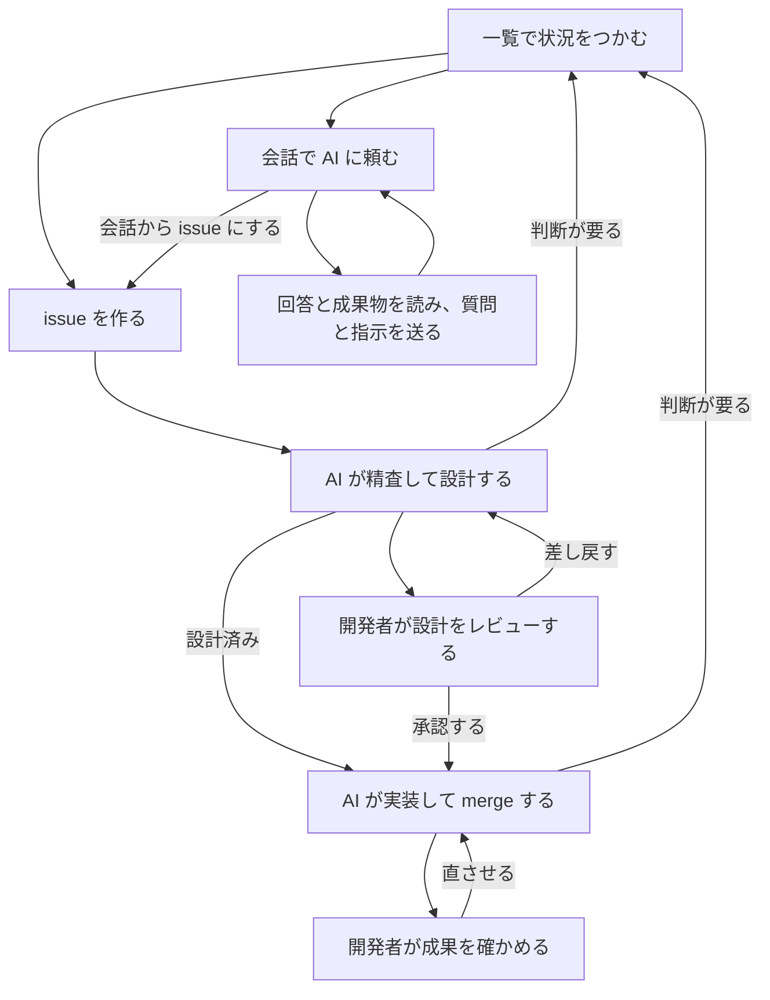
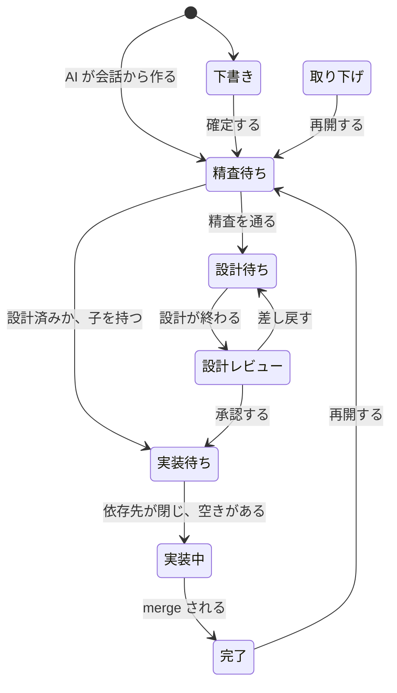

# sukuna の全体像

- 種別: 仕様の概要
- 対象読者: 仕様の概要を知りたい人
- 詳細の正本: [機能設計書](features/)、[横断設計](DESIGN.md)、[ユースケースと用語](USECASES.md)

## 何のシステムか

Claude Code のエージェントを、プロジェクト・issue・会話の単位で動かして見張るための Web アプリである。

- Mac Studio に常駐させ、Tailscale につないだ PC のブラウザから使う。使うのは開発者 1 人である
- 画面はすべて Vim と同じキーで操作する。マウスを使わずに、読む・選ぶ・指示するができる
- AI は、画面を開いているかどうかに関係なく動き続ける。開発者は、対応が要るものを一覧で受け取り、通知を有効にしていれば通知でも受け取る

## だれが何をするか

| 利用者 | すること | しないこと |
| --- | --- | --- |
| 開発者 | 会話で AI に作業を頼む。issue を作る。設計を承認する。必要な issue だけ merge の前に確かめる | 既定では、精査・設計・実装の AI を手で起動すること。設計書の反映と merge の操作 |
| AI | 会話で作業する。issue を精査し、設計し、実装し、PR を作って merge する | 設計の承認。issue の状態を自分で移すこと |
| アプリ | AI を起動する。issue の状態を移す。worktree を作って片付ける。対応が要る変化を知らせる | 開発者が書いた内容を、開発者の操作なしに送ること |

## 仕事の流れ

開発者の入口は 2 つある。会話で直接頼む流れと、issue を作って AI に任せる流れである。

- **一覧で状況をつかむ**: 全プロジェクトの会話と issue を、判断待ち・指示待ち・作業中に分けて並べる ([一覧と通知](features/inbox.md))
- **会話で AI に頼む**: 指示を送り、発言・ツールの実行・差分を読み、質問に答える ([会話](features/conversation.md))。別の作業から戻ったときは、未読の先頭と、答える質問から読み始める ([会話の振り返り](features/recap.md))
- **質問と指示を送る**: 回答やファイルの箇所を選んで、質問か指示をストックにためてから送る。質問は 1 件ごとに、元の会話から分かれたスレッドになる ([ストックとスレッド](features/stock-thread.md)、[ファイル](features/files.md))
- **issue を作る**: 下書きを書いて確定すると、既定では AI が動き始める ([issue](features/issue.md))
- **AI が精査して設計する**: 既定では、開発者が起動しなくても、精査、設計の順に進む。設計済みの issue は、精査のあと実装へ進む ([精査と設計の自動フロー](features/issue-flow.md))
- **設計をレビューする**: 修正方針と設計書の差分を読み、承認するか差し戻す ([設計レビュー](features/design-review.md))
- **AI が実装して merge する**: issue ごとの worktree で実装し、GitHub を使うプロジェクトでは PR と CI を通して merge する ([実装の自動フロー](features/implementation-flow.md))。動いているあいだは、工程と進み具合を見られる ([作業の見守り](features/work-monitor.md))
- **成果を確かめる**: PR の差分を読み、指示を送って直させるか、merge を許可する ([PR のレビュー](features/pr-review.md))

## issue の状態

- 図に無い移り変わり: 精査待ち・設計待ち・実装中の issue は、AI の質問、失敗、利用枠切れ、CI の失敗、merge 前の確認で **停止中** になる。開発者が答える、指示を送る、再開を選ぶなどで、元の段階に戻る
- 依存先の issue が取り下げられた issue も、停止中になる
- 完了と取り下げを除くどの状態からも、開発者は取り下げられる。完了した issue は、実装の会話に指示を送ると実装中に戻る
- 子を持つ issue は実装の対象にならず、子がすべて閉じ、1 件以上が完了すると、完了になる

## 仕様の中心になる決まり

1. **issue の状態を移すのはアプリだけである。** AI は、精査の結果や実装の完了をアプリに報告する。
2. **設計の承認は開発者だけが行う。** AI は承認しない。
3. **merge は自動で行う。** 開発者が指定した issue だけ、merge の前に確認を待つ。
4. **同じ issue で動く AI は、同時に 1 つだけである。** 1 つのプロジェクトで同時に実装する issue は 5 件までで、件数は設定で変えられる。
5. **送る前のものは、原則として、送るか自分で消すまで残る。** 書きかけの入力、ストック、送る前の回答、届く前の指示が当たる。送る前の回答は、AI が次の応答を始めると消える。
6. **AI の質問への回答は、まとめて 1 通で送る。** 選択肢を選んだだけでは送らない。
7. **AI が作業中に送った指示は、作業が終わると届く。** 割り込みを選ぶと、AI を止めてすぐに届ける。AI を止めたときと失敗で止まったときは、届かずに残る。
8. **利用枠切れで止まった作業は、枠が戻ると自動で再開する。** 失敗で止まった作業と、再起動で止まった開発者の会話は、開発者が再開を選ぶか指示を送るまで動かない。
9. **対応が要る変化は、一覧に出て、通知を有効にしていれば通知にも出る。** いま開いて見ている会話と issue には、通知を出さない。
10. **取り返しのつかない操作は、実行の前に確認を挟む。** 承認、merge の許可、取り下げ、削除が当たる。

## 機能の一覧

| 業務 | 機能 | 一言でいうと |
| --- | --- | --- |
| 状況をつかむ | [一覧と通知](features/inbox.md) | 会話と issue を、次に対応する順に並べ、変化を知らせる |
| 状況をつかむ | [作業の見守り](features/work-monitor.md) | 動いている AI の工程と進み具合を見せ、止める・続きを頼む |
| 会話する | [会話](features/conversation.md) | AI に指示を送り、出力を読み、質問に答える |
| 会話する | [会話の振り返り](features/recap.md) | 未読の先頭、答える質問、目次、決まったことを見せる |
| 会話する | [ストックとスレッド](features/stock-thread.md) | 箇所を選んだ質問と指示を書きためて送る |
| 会話する | [ファイル](features/files.md) | 会話が動いているディレクトリのファイルを探して読む |
| 会話する | [会話の締めくくり](features/conversation-lifecycle.md) | 成果と残りを確かめて閉じ、あとから探して再開する |
| issue を進める | [issue](features/issue.md) | issue を作り、親・依存・優先度を管理する |
| issue を進める | [精査と設計の自動フロー](features/issue-flow.md) | 確定した issue を AI が精査して設計する。状態の移り変わりを決める |
| issue を進める | [設計レビュー](features/design-review.md) | 設計を読み、承認するか差し戻す |
| issue を進める | [実装の自動フロー](features/implementation-flow.md) | AI が実装し、PR と CI を通して merge する |
| issue を進める | [PR のレビュー](features/pr-review.md) | PR を読み、直させるか merge を許可する |
| worktree とターミナル | [worktree とターミナル](features/worktree-terminal.md) | worktree を作って消し、ターミナルでコマンドを実行する |
| 設定と運用 | [プロジェクトの設定](features/project-settings.md) | プロジェクトを登録し、AI の動かし方と自動フローを設定する |
| 設定と運用 | [導入と運用](features/operations.md) | 常駐、本人の確認、更新、バックアップ、キーの割り当て |
| 土台 | [バッファの土台](features/buffer-ui.md) | すべてのウィンドウを Vim のバッファとして作る |
| 土台 | [実行の土台](features/runtime.md) | AI を動かす部分と画面を分け、出力を保存して届ける |

## 作らないもの

- スマホの画面。初期版は PC だけを作る
- ダークテーマ
- 複数人での利用
- エージェントの出力を並べる表示

全件と理由は [横断設計の「目的とスコープ」](DESIGN.md) と [ユーザーストーリーの「やらないこと」](USER_STORIES.md) にある。
